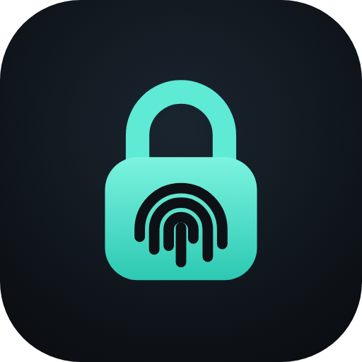

<p align="center">
  
</p>

<h1 align="center">App Lock</h1>

<p align="center">
  Lock any Android app behind your fingerprint, with a backup PIN.<br>
  Built with Flutter and Kotlin.
</p>

<p align="center">
  
  
  
</p>

---

## What it does

You choose apps such as WhatsApp, Instagram or Photos. When one of them opens, App Lock
covers it with a lock screen and asks for your fingerprint. If the fingerprint doesn't
work, you can use your backup PIN instead.

I built it as a personal project for my Motorola Edge 40 Neo (Android 15, in-display
fingerprint sensor). It should work on most Android phones with a fingerprint sensor.
It is not on the Play Store. You install it as an APK.

## Features

- **Fingerprint unlock** using Android's own fingerprint popup.
- **Backup PIN** (4–6 digits). After 5 wrong tries you wait 30 seconds.
  "Forgot PIN?" lets you in with your phone's screen lock.
- **Pick apps to lock** from a searchable list of your installed apps, with one master switch.
- **Fast lock screen**: the lock screen's Flutter engine starts in the background when the
  app starts, so the lock screen appears without a delay.
- **Re-lock timer**: lock again right away, after 1 minute or after 5 minutes of leaving an app.
- **Lock when the screen turns off**: every app is locked again when the screen goes off.
- **Lock Settings & Play Store**: stops someone from uninstalling App Lock or turning it off.
- **Hide previews in Recents**: App Lock's screens show as a blank card in Recent apps.
- **Health check** that shows whether every permission is still on, with a tap to fix each one.
- **Light and dark themes** that follow the phone's system setting.

## Privacy

- Nothing leaves the phone. The app has no internet permission and no analytics.
- **Your PIN is never stored.** Only a salted hash is kept: a random 16-byte salt, then
  SHA-256 repeated 10,000 times. It is saved in Android's encrypted storage
  (`flutter_secure_storage`).
- The app never sees your fingerprint. Android checks it and only tells App Lock whether
  it matched.
- The Accessibility service only reads **which app** is on screen (its package name).
  It is set up so it cannot read what is on the screen (`canRetrieveWindowContent="false"`).

## How it works

```
 You open WhatsApp
        │
        ▼
 LockAccessibilityService  ──  "a new app window opened: com.whatsapp"
        │   Is it locked? Was it unlocked recently?
        ▼
 LockActivity  (uses the pre-warmed FlutterEngine from FlutterEngineCache)
        │   Dart entry point lockMain() draws the lock screen
        ▼
 Fingerprint or PIN OK  →  the lock screen closes and WhatsApp is underneath
```

| Part | Language | Job |
|---|---|---|
| `LockAccessibilityService` | Kotlin | Watches which app comes to the front and starts the lock screen |
| `LockActivity` + `LockEngine` | Kotlin | Shows the lock screen with a cached, pre-warmed Flutter engine |
| `UnlockSession` | Kotlin | Remembers unlocked apps until the re-lock timer runs out or the screen turns off |
| `LockedAppsStore`, `SettingsStore` | Kotlin | Saves the locked apps and settings so the service can read them without Flutter |
| `NativeChannel` | Kotlin | MethodChannel `app_lock/native` between the Flutter screens and Android |
| `lib/screens/` | Dart | All screens: welcome, set PIN, permissions, home, lock, lock PIN, settings |
| `lib/services/` | Dart | PIN hashing, fingerprint (`local_auth`), settings, permission checks |

App Lock never locks itself, the home-screen app or the system UI.

## Project structure

```
lib/
  main.dart            App start; lockMain() is the lock screen's entry point
  routes.dart          Screen names and navigation
  screens/             The 7 screens
  lock/                Lock-screen app that runs in the pre-warmed engine
  services/            PIN, fingerprint, settings, permissions, native bridge
  theme/               Colors (light + dark) and fonts
  widgets/             Shared buttons, switches, keypad, app tiles
android/app/src/main/kotlin/com/krishna/applock/
                       Accessibility service, lock activity, storage, bridge
design/                Approved screen designs (HTML, dark + light) and the logo
test/                  Dart unit and widget tests
android/app/src/test/  Kotlin unit tests for UnlockSession
```

## Build and install

You need the [Flutter SDK](https://docs.flutter.dev/get-started/install) and the Android SDK
(Android Studio installs it).

```bash
git clone https://github.com/Krish1712204/App-Lock.git
cd App-Lock
flutter pub get

flutter run                      # run on a connected phone
flutter analyze                  # check the code
flutter test                     # run the Dart tests
flutter build apk --release      # build the APK
```

The APK is saved to `build/app/outputs/flutter-apk/app-release.apk`.

> The release build is signed with the local **debug key**, which is fine for a personal
> sideloaded app. To publish the app, set up your own signing key first.

## First-time setup on the phone

1. Install the APK and open **App Lock**.
2. Create your backup PIN.
3. Turn on the permissions the app asks for:
   - **Accessibility**: lets App Lock see which app opens.
   - **Display over other apps**: lets the lock screen open on top of other apps.
   - **Fingerprint**: a fingerprint must be saved in the phone's settings.
   - **Battery: Unrestricted**: stops Android from closing App Lock in the background.
4. Pick the apps to lock and turn on the master switch.

**Accessibility switch greyed out?** Android 13 and newer block this for apps that aren't
from the Play Store. Go to **Settings → Apps → App Lock → ⋮ (top right) → Allow restricted
settings**, then turn on Accessibility again.

**Lock stops working after a while?** Some phones close background apps to save battery.
Set App Lock's battery use to **Unrestricted**, and lock App Lock in Recent apps if your
phone allows it.

## Limitations

- On Android, an app lock can only cover an app once it has opened, so you may see the app
  for a moment before the lock screen appears.
- If someone turns off the Accessibility service, nothing gets locked. Turn on
  **Lock Settings & Play Store** to make that harder.
- Android only. There is no iOS version, because iOS doesn't let apps lock other apps.

## Tech stack

Flutter (Dart) · Kotlin · `local_auth` · `flutter_secure_storage` · `crypto` · `flutter_svg`

Fonts: [Inter](https://rsms.me/inter/) and [Space Grotesk](https://github.com/floriankarsten/space-grotesk),
both under the SIL Open Font License.
